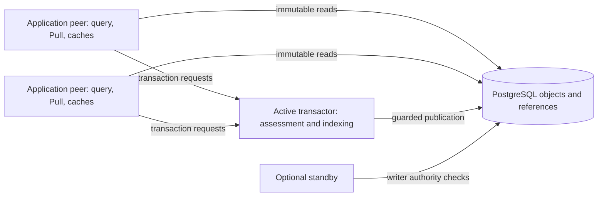

# Start with EDB

EDB is a general purpose database system designed for data-of-record applications.
An EDB database is a set of immutable atomic facts called datoms. Ordinary EDB
transactions add assertions and retractions, rather than changing existing facts,
so you can retain an audit trail and query “as of” points in time. Transactions
are serialized in a total order; the native transaction engine validates changes
and publishes them atomically to durable PostgreSQL storage.

EDB has a powerful and flexible information model. Each database declares an
attribute-level schema, and any entity can possess any attribute. You can query
your data with Datalog, a logic-based query language, and navigate hierarchies
with Pull. EDB's indexes support many access patterns common in relational,
column, key/value, hierarchical and graph databases.

EDB is implemented in Rust. Applications capture immutable database values and
evaluate Datalog, Pull and entity navigation locally. A transactor serializes
writes; PostgreSQL stores authenticated immutable objects and guarded references.
The native library, asynchronous adapters and EDN command-line interface use the
same information model and semantic engine. There is no JVM or Lucene ABI
dependency.

## About the overview

This overview provides a concise description of EDB, with links to the reference
for comprehensive detail. After reading it, you should know whether and where
EDB might be useful to you, how its components fit together, which interface to
use, and how to get started learning EDB.

The overview covers the [information model](#information-model), its
[benefits](#benefits) and [tradeoffs](#tradeoffs), the
[architecture](#architecture), [data structures](#data-structures),
[deployment topology](#topology), [deployment choices](#deployment-choices),
and [interfaces](#edb-interfaces).

For many people, the most efficient way to begin learning EDB is to read this
overview in its entirety, following the links for more detail as needed. If you
prefer a hands-on introduction, start with the
[EDN tutorial](../01_tutorials/00_edn_workflow.md) for file/stdin commands, or the
[separate Rust application](../01_tutorials/01_application_workflow.md) for
explicit installation, a writer process and restart-safe submission. Neither
runtime startup nor a query implicitly provisions storage.

## Guide chapters

| Chapter | What you can do |
| --- | --- |
| [Tutorials](../01_tutorials/00_edn_workflow.md) | Install schema, transact data and read it from a separate application. |
| [Database values](../02_core_concepts/00_database_values.md) | Capture, compose, compare and reopen immutable views. |
| [Schema](../03_schema/00_schema.md) | Declare attributes, references, uniqueness and managed tuples. |
| [Transactions](../04_transactions/00_transactions.md) | Submit logical intent, interpret reports and reconcile unknown outcomes. |
| [Queries and Pull](../05_query_and_pull/00_queries.md) | Join facts and application data, aggregate, navigate and search. |
| [Indexes and logs](../06_indexes/00_indexes_and_log.md) | Traverse ordered datoms and exact transaction history. |
| [Native peer API](../07_peer_api/00_connections.md) | Capture and synchronize reads, use async workers and consume changes. |
| [Operations](../08_operations/00_deployment.md) | Deploy, administer, inspect, back up and restore. |
| [Optional local cache](../09_optional/00_local_cache.md) and [hints](../09_optional/01_transaction_hints.md) | Opt into disposable caching or advisory prefetch. |

The [documentation reference](../README.md) indexes the complete guide.

## Information model

An EDB database is a single universal relation of facts called datoms. Datoms
can be either assertions indicating that something is known to be true at a
point in time or retractions indicating that something is no longer known to be
true. Datoms are atomic and immutable. Ordinary transactions atomically add a
set of datoms to a database; they do not overwrite the previous assertions.

Each datom relates an entity ID (E) to a value (V) via an attribute (A).
Attributes have a schema: value type and cardinality must be declared before an
attribute is used. A value can be one of the built-in types, including entity
references, strings, keywords, numbers, booleans, instants, UUIDs, URIs, bytes and
tuples. The E/A/V portion of a datom is similar to the triples of a traditional
triple store. Each datom also includes the ID of the transaction entity (Tx) that
added it, a source entity ID (S) explicitly supplied by the application, and a
boolean indicating whether it is an assertion or retraction:

```text
[Entity  Attribute  Value  Transaction  Source  Added-or-retracted]
```

The source is an ordinary entity describing the person, institution, publication
or other origin to whom the statement is attributed. One transaction can contain
facts from several sources. A retraction carries its own source; it does not
change the attribution of the earlier assertion.

Datoms sharing a common E can be projected into an entity, an associative
attribute-to-value view of the assertions with that entity ID as of a given
point in time. Cardinality-one attributes have at most one current value;
cardinality-many attributes can have a set of values. Two sources asserting the
same value retain distinct attribution while contributing one value to this
view. Reference values connect entities without requiring a separate join-table
model.

For example, after installing the attributes, this EDN transaction records two
facts about a person. Assume entity `99` identifies the contributor:

```edn
[[:db/txInstant 99]
 {:db/source 99
  :person/name "Alice"
  :person/email "alice@example.com"}]
```

The `[:db/txInstant 99]` form asserts the current transaction's selected
`:db/txInstant` with source `99`. Each domain map supplies its own attribution
through `:db/source`.

If `:person/email` is unique, a later transaction can identify that person with
a lookup reference and change the name:

```edn
[[:db/txInstant 99]
 {:db/id [:person/email "alice@example.com"]
  :db/source 99
  :person/name "Alicia"}]
```

For a cardinality-one name, the resulting transaction retracts the old value
and asserts the new one, both attributed to source `99`. The omitted email remains
unchanged. A captured pre-transaction value still sees Alice; a post-transaction
value sees Alicia.
The [transaction data reference](../04_transactions/04_transaction_data.md)
explains entity maps, identifiers, assertions and retractions.

EDB ensures that transactions are serialized in a total order, accessible
programmatically through logical time `t` and the database value's `basis_t`.
The transaction entity ID and `t` are related representations, not interchangeable
raw numbers. Transactions are themselves entities, recording wall-clock time
in `:db/txInstant` along with additional datoms you choose to add. This gives
transaction metadata, such as the purpose of a change, the same queryable form as
application facts. Each of these datoms also has its own source.

Schema is also data: an attribute is an entity whose facts describe its name,
value type, cardinality and other constraints. See
[schema](../03_schema/00_schema.md) and
[identity and values](../03_schema/01_identity_and_values.md).

### Benefits

The EDB information model has the following benefits:

- **Independent read scaling:** because database values and index objects are
  immutable, multiple processes can retain copies of data to serve read loads.
  Readers do not coordinate with the writer to query a captured value. Storage
  access, process resources and working-set size still determine actual capacity.
- **The database within your application:** application processes have their own
  copy of the query engine and cache database data in local memory. This enables
  low-latency access and supports navigation patterns that would be expensive
  with a server roundtrip for every attribute or relationship.
- **Auditability:** the total ordering of transactions and retention of assertions
  and retractions let you inspect the steps in the history of your data and the
  source of each statement.
  Transaction entities offer a place to store domain-specific provenance metadata.
  History retention and excision policies determine what remains available.
- **History:** because datoms record their transaction, database values can be
  filtered to include retained data as of a specific point in the past. Existing
  queries can be used against these as-of values without rewriting their logic.
- **Powerful query:** the universal relation of datoms is well suited for Datalog
  joins and recursive rules. Queries can combine database values, transaction
  logs and ordinary application relations, and use aggregation and Pull.
- **Direct data modeling:** if you think of domain entities as associative
  collections of facts, your logical model translates directly to EDB's
  information model. References express relationships using the same facts.
- **Flexibility:** any entity can possess any attribute, a good fit for real-world
  data where exceptions are common. There is no need for a SQL-style NULL for
  absent attributes: datoms either exist or they do not. Tuple slots have their
  own explicit nil rules.
- **Efficiency across multiple read access patterns:** EAVT supports entity or
  “row” access, AVET supports attribute/value lookup, AEVT supports attribute or
  “column” access, and VAET supports reverse reference and graph navigation.

### Tradeoffs

There is no such thing as a free lunch. EDB's information model has the following
tradeoffs:

- **No per-database write scaling:** transactions are totally serialized, so a
  given database has one active writer. Adding peers increases read capacity;
  it does not create concurrent writers for that database.
- **Data growth:** retaining changes costs storage and maintenance work. High
  churn, nontransactional data such as observability telemetry may be a poor fit
  when its history is not useful to the application.
- **No fixed structural types:** the universal schema does not assign each entity
  to a table or a closed set of attributes. Where you need requirements such as
  “a person must have a name,” use explicit transaction-time entity specifications
  and predicates. Declaring an attribute alone does not require every entity to
  possess it.
- **Local execution has local costs:** peers need memory and CPU for query work,
  recent data and caches. Queries and lazy navigation may load cold data from
  PostgreSQL. Local evaluation is not a promise that every read is already in RAM.

EDB has string and byte values, but bounded value, transaction and object formats
make it unsuitable as an unbounded document or media store. For large documents,
images, audio or video, store the content in an appropriate object store and
record a durable identifier, URI or hash in EDB. Account for the separate
lifecycle of that content in your application.

This combination of benefits and tradeoffs is useful for data of record,
configuration and application state whose identity, relationships and changes
matter. Evaluate the implementation's resource limits and operational behavior
against your own workload; this overview does not establish a throughput or
availability guarantee.

## Architecture

EDB's architecture separates immutable database values from the processes that
advance a live database. This section describes that design, the data structures
that support it, and the topology of an EDB deployment.

### Immutable values and functional change

EDB encourages a value-oriented style of application programming:

- A `DatabaseValue` is an immutable value. Capture it once and pass it through
  application functions that need a consistent view. Advancing a connection
  never changes an older value.
- A transaction is an atomic change from a db-before to a db-after. Its report
  includes those values, transaction datoms and resolved temporary IDs.
- Local `with` operations produce speculative db-after values for inspection.
  They do not publish storage, reserve identities or replace authoritative
  transaction assessment when the intent is submitted.
- Entities are open associative collections of attributes. Pull projects plain
  results; the native entity API can navigate attributes lazily.
- Queries, transaction forms and Pull patterns can be expressed as data. EDN is
  a text authoring and interchange layer over the Rust engine, not a Clojure
  runtime or a mechanism for executing arbitrary code.

Use [database values](../02_core_concepts/00_database_values.md) to compose
reads and [transactions](../04_transactions/00_transactions.md) to submit
changes. Persisted native programs and compiled Rust callbacks are explicit
extension mechanisms; see [stored programs](../04_transactions/01_persisted_programs.md)
and [native computation](../07_peer_api/02_native_computation.md).

This first-release development line uses current native storage, request and
program formats. Unsupported historical formats fail explicitly; installation
never resets data. Format changes may require fresh databases. There is no
automatic historical-upgrade promise.

## Data structures

EDB has two key durable data structures: indexes and the log. PostgreSQL stores
their opaque, content-addressed objects and the guarded references that publish
a coherent database state. PostgreSQL does not execute EDB Datalog or interpret
application attributes as SQL columns.

### Indexes

An EDB database is logically a set of datoms. To make this structure practical,
EDB provides indexes and query capabilities that use those indexes.

EDB maintains four different index orders designed to support different access
patterns. The durable implementation is an immutable, shallow tree: roots and
directories contain routing keys and child hashes, while leaf segments hold
datoms in parallel columns. Each node is a separate authenticated storage object,
similar in purpose to a page in a traditional relational database.

| Index | Sort order | Contains |
| --- | --- | --- |
| EAVT | Entity / attribute / value / transaction | All applicable datoms |
| AEVT | Attribute / entity / value / transaction | All applicable datoms |
| AVET | Attribute / value / entity / transaction | Indexed or unique attributes whose projection is ready |
| VAET | Reference value / attribute / entity / transaction | Reference-valued datoms |

Within a logical E/A/V group, newer transactions sort first, followed by source
ID in ascending order and assertions before retractions. All four indexes retain
source attribution. Current and history views use their corresponding trees
plus captured recent information; history
exposes assertions and retractions. Schema's indexing intent and completed
physical indexing are distinct. Use `DatabaseValue::has_avet` to inspect readiness
on the captured value, or synchronization APIs to await the required publication.

Query and Pull use available indexes through the shared read engine. Decoded
immutable nodes are kept in an entry- and byte-bounded LRU cache. An optional
[local SSD cache](../09_optional/00_local_cache.md) supplies authenticated bytes
before a PostgreSQL object read. These caches have several implications:

- Databases can exceed application memory: cold index nodes are loaded as needed.
  A cursor can therefore encounter I/O and errors during traversal.
- An application can access its resident working set without foreground SQL.
  Working-set locality can reduce latency, while cache misses still depend on
  storage availability and latency.
- Distinct peers can cache different working sets, allowing different processes
  to serve different access patterns. Cache limits bound the documented cache
  accounting, not the entire process's memory or all caller-retained values.

Index construction reuses untouched immutable nodes and merges changes into
selected paths. Peers combine durable indexes with recent transactions, so
indexes need not be rebuilt on every commit. Background indexing can publish
new indexes without changing already captured database values. Explicit recovery
or a new attribute's backfill can require substantially more work than an
ordinary incremental merge. See [indexes and logs](../06_indexes/00_indexes_and_log.md).

### Log

EDB's transaction log is ordered by logical time `t`. Each `t` represents one
transaction. Transaction data is a set of datoms, not a sequence of imperative
updates; its canonical physical encoding does not give input forms an execution
order.

The durable log uses immutable transaction entries, a bounded tail page and
backward skip links. Appending writes the new entry and a replacement tail page;
large entries use additional payload chunks. Sealed pages remain unchanged.
The log has the following properties:

- **Accumulating:** ordinary transactions add information. Where an
  update-in-place database would delete a fact, EDB adds a retraction.
- **Chronological:** the retained log records the database's transactions in their
  total order, including additions and retractions.
- **Transactional:** the writer assesses changes against one database basis and
  publishes the resulting state atomically under its guarded writer authority.
- **Accessible:** the log is part of the information model, not merely an
  implementation detail. `Connection::log()` and `Peer::log()` capture immutable
  endpoints; `LogValue::tx_range` traverses transactions and `tx_data` selects
  an exact transaction. Queries can also use a log source.

An indexed history view and the log are different interfaces. `:db/noHistory`
consolidation can omit old facts from indexes while the log retains the original
transaction datoms. Explicit [excision](../08_operations/00_deployment.md#excision)
can replace retained information, including log generations, so the log is not
an exemption from the database's removal policy. Capturing it does not pin
storage forever.

## Topology

EDB decomposes capabilities of a traditional database server into transactions,
query, catalog operations, indexing, caching and storage. The Rust library and
process interfaces let these capabilities run together or in separate processes
while retaining the same PostgreSQL storage boundary.



This topology supports the following objectives:

- **Reads inside the application:** each peer includes the query engine as a
  library. Multiple peers can serve read requests independently, and captured
  values remain immutable while new transactions are committed.
- **One transaction authority:** an active transactor owns guarded writer
  authority. A standby can take over through the lease and fencing protocol.
  Native transaction functions and predicates can validate or transform intent
  during assessment. They should compute from supplied data, without external
  side effects that a retry could duplicate.
- **Separate storage:** PostgreSQL supplies durable object and reference storage
  in `edb_objects` and `edb_refs`. Operators provision PostgreSQL, credentials,
  replication, backups and availability according to deployment requirements.
- **Reusable immutable caches:** cached objects do not need content invalidation
  when new transactions arrive. New captures still require current authorization,
  and historical access remains subject to retention and excision policy.
- **Independent index publication:** the transaction service owns writer and
  indexing workers. Recent data bridges the durable index basis and the captured
  transaction basis, allowing indexing to proceed separately from each commit.

Writer failover does not supply PostgreSQL high availability, and it does not
establish a universal recovery-time bound. Peers can continue resident reads
while a writer is unavailable; cold reads still need storage. See
[deployment](../08_operations/00_deployment.md) and
[observability](../08_operations/03_observability.md).

## Deployment choices

EDB provides one native engine with several ways to compose it. Choose the
boundary according to durability, process ownership and operational needs.

| | In-memory values | Live PostgreSQL application | Portable backup reads |
| --- | --- | --- | --- |
| Entry point | `Database::bootstrap` and local `with` | `Connection` or `Peer`; explicit transaction service | `BackupConnection` or CLI `--repository` |
| Storage | Application memory | Explicitly installed PostgreSQL storage | Local backup repository |
| Writes | Speculative value construction | One active transactor; in-process, same-host socket or verified TLS submission | Read-only; restore explicitly before live writes |
| Reads | Local native engine | Local native engine plus storage reads on misses | Local native engine over captured backup objects |
| Persistence | No durable commit or retry receipt | Published log, indexes and exact request receipts | Captured immutable backup point |
| Read scaling | Within the application | Run additional application peers | Open independent repository readers |
| Availability | Application lifetime | Application supervision, writer failover and PostgreSQL availability | Repository availability |
| Operational ownership | Application owns values | You provision storage, credentials and processes | You capture, verify and retain backup media |

An in-process `Connection::start` explicitly owns a PostgreSQL-backed transaction
service; it is not an automatically provisioned local-disk database. A separately
supervised `edb transactor` is useful when application restarts should not own
the writer's lifetime. Optional standbys provide a writer takeover mechanism.

A [portable backup](../08_operations/05_backup_reads.md) supports intentional
offline query, Pull and log access without PostgreSQL or a restore. An SSD cache
is disposable acceleration for a live peer, not a substitute for a portable
backup or disconnected startup.

## EDB interfaces

EDB exposes a native synchronous API, asynchronous adapters and an EDN frontend.
They share the model and engine, but differ in authoring form and how application
code schedules work.

- The **native peer API** exposes `Connection`, `Peer` and immutable
  `DatabaseValue` objects. It includes typed transactions, Datalog, Pull, lazy
  entities, ordered index cursors, temporal views, filters, log access and
  native extension registries. A connection coordinates observation and
  submission; the captured value is the input to a consistent read.
- The **async API** uses `AsyncClient` and `AsyncExecutor` to schedule blocking
  native work on a fixed worker pool. Futures and streams integrate with Rust
  async applications. This is an adapter over the same local query engine,
  not a remote query service. Consumed native values keep their synchronous
  read behavior and may perform storage I/O.
- The **EDN frontend** accepts schema and transaction data, queries and Pull
  patterns as text. The `edb` executable supports files/stdin and prints EDN
  results. Rust applications can use the EDN reader and adapters directly.
  The stock CLI does not dynamically load compiled Rust callback registries.

| Capability | Native synchronous API | Async adapters | EDN CLI |
| --- | --- | --- | --- |
| Query location | Application process | Fixed native worker pool | CLI process |
| Transactions | Typed or EDN requests | Native requests through attached or configured transport | `transact` with caller-owned request key |
| Query and Pull | Typed APIs and EDN adapters | Scheduled query/Pull and sequences | `query`, `pull` |
| Lazy entity navigation | Native `Entity` | Returned native values retain synchronous behavior | Pull output |
| Index access | EAVT, AEVT, AVET, VAET cursors and ranges | Index collection on workers | Use the native API for raw cursor access |
| Temporal views | As-of, since, history and predicate filters | Captured native source values | Query as-of/since/history; point-in-time Pull |
| Transaction log | Immutable log and transaction ranges | Captured log streams | Query log sources |
| Local speculation | `with` and form/EDN variants | Native value operation | `with` |
| Catalog administration | Native catalog/operator APIs | Use the synchronous owning API | Explicit installation, create and administration commands |
| Native callbacks | Explicit application registries | Registries remain engine inputs | Requires a compiled application for custom native deployment |

Transaction submission carries a caller-owned key and exact request content.
After ambiguous delivery, retry or reconcile that same request; a new key means
a new intent, not recovery of the previous outcome. A confirmed commit can have
a local report-opening error without being rolled back. Submission order across
independent clients is not a substitute for the committed transaction order.
See [transactions and retries](../04_transactions/00_transactions.md),
[native connections](../07_peer_api/00_connections.md),
[async clients](../07_peer_api/01_async_client.md) and the
[EDN frontend](../01_tutorials/00_edn_workflow.md).

## Choose the boundary deliberately

Live peers need authorized PostgreSQL access for opening and cold object reads.
They do not send queries to the transactor. Same-host sockets and verified-TLS
remote routing submit transactions; they are not query gateways. Storage
credentials are a trusted deployment boundary, not per-entity application
permissions. For intentional offline operation, open a
[portable backup](../08_operations/05_backup_reads.md).

Captured values do not register reader pins. Configure collection grace to cover
reads, lagging report consumers and backup capture; the normal recommendation is
30 days. A held value or serialized reference cannot prevent cold data from being
collected after that grace. See
[retention](../02_core_concepts/00_database_values.md#captured-value-retention).

Cooperative resource controls do not preempt arbitrary Rust callbacks or blocked
storage calls. Use the owning API's limits and the
[transport policy](../08_operations/00_deployment.md#transport-and-failure-policy).

## Get started

Use [EDB setup](01_setup.md) to build the executable and start a transactor,
and [accessing the peer library](02_peer_library.md) to add EDB to a Rust project.
[Language support](03_language_support.md) compares typed Rust and EDN interfaces.
The [in-memory tutorial](../01_tutorials/02_in_memory.md) introduces schema,
transactions, queries and history without a storage service.

Continue with the [EDN tutorial](../01_tutorials/00_edn_workflow.md) to build
`edb`, explicitly install storage and create a database, start a transactor,
and transact and query the supplied examples. For library integration, complete
the [Rust application tutorial](../01_tutorials/01_application_workflow.md),
including separate runtime roles, writer startup and restart-safe exact retries.
Use the [documentation reference](../README.md) as you explore schema, temporal
queries, transactions and operations in more detail.
