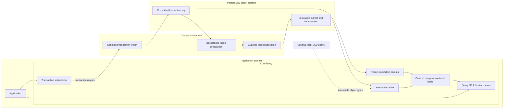

# Indexes

This page provides an explanation of each of the indexes EDB maintains.

EDB maintains six indexes that contain ordered sets of datoms. Each of these
indexes is named based on the leading sort order used. Each index retains all six
datom components, `[e a v t s added?]`. E, A, V, and S sort ascending;
T sorts descending. The four source-independent orders place S after T; the
source-first orders place S first. Assertions sort before retractions:

| Index | Sort order | Contains |
| --- | --- | --- |
| EAVT | entity / attribute / value / tx / source / added? | all datoms in the selected view |
| AEVT | attribute / entity / value / tx / source / added? | all datoms in the selected view |
| AVET | attribute / value / entity / tx / source / added? | `:db/unique` or `:db/index` attributes whose projection is ready |
| VAET | value / attribute / entity / tx / source / added? | `:db.type/ref` attributes |
| SAEVT | source / attribute / entity / value / tx / added? | all datoms in the selected view |
| SAVET | source / attribute / value / entity / tx / added? | the same ready indexed or unique attributes as AVET |

Entity, attribute, and source components sort by their numeric IDs, not by their
ident names. Values use EDB's value comparison. For the same E/A/V, transaction,
and source, `added? = true` sorts before `false`; stored value representation
breaks any remaining ties. A datom's `tx` is a transaction entity ID; logical T
and transaction IDs have distinct native representations.

The tables below show illustrative slices of a music database, not output from
an installed sample dataset. Small entity and transaction numbers stand in for
allocated IDs; source entity 99 identifies the contributor in these examples.
Attribute names stand in for numeric attribute IDs; these examples
assume `:release/artistCredit`, `:release/artists`, `:release/name`, and
`:release/year` have ascending attribute IDs. Rows outside each illustrated slice
are omitted.

All current indexes describe the same shared record. Cardinality and uniqueness
apply across sources. A retraction of an E/A/V withdraws that value's contributions
from every source before an index prefix or filter selects a contributor. History
retains each assertion's original source and the retracting transaction's source.

## EAVT

The EAVT index provides efficient access to everything about a given entity.
Conceptually this is very similar to row access style in a SQL database, except
that entities can possess arbitrary attributes rather than being limited to a
predefined set of columns.

The example below shows the scalar facts about entity 42 grouped together:

| E | A | V | Tx | S | Added? |
| --- | --- | --- | --- | --- | --- |
| 41 | `:release/name` | "Abbey Road" | 1007 | 99 | true |
| 42 | `:release/artistCredit` | "The Beatles" | 1007 | 99 | true |
| 42 | `:release/name` | "Magical Mystery Tour" | 1007 | 99 | true |
| 42 | `:release/year` | 1967 | 1007 | 99 | true |
| 43 | `:release/name` | "Let It Be" | 1234 | 99 | true |

EAVT is also useful in master or detail lookups, since the references to detail
entities are just ordinary values alongside the scalar attributes of the master
entity. Entities allocated together in the same partition have nearby numeric
IDs, giving their facts locality in EAVT. This does not guarantee that all related
entities occupy a single physical segment. See [partitions](../04_transactions/02_partitions.md)
for placement choices. Allocation order is not a transaction-time boundary:
`entid_at` does not reliably select newly created entities under native allocation;
see [new entity scans](../04_transactions/02_partitions.md#new-entity-scans).

## AEVT

The AEVT index provides efficient access to all values for a given attribute,
comparable to the traditional column access style. In the table below, notice how
all `:release/name` attributes are grouped together. This allows EDB to query for
all values of the `:release/name` attribute by traversing one contiguous attribute
range.

| A | E | V | Tx | S | Added? |
| --- | --- | --- | --- | --- | --- |
| `:release/artistCredit` | 42 | "The Beatles" | 1007 | 99 | true |
| `:release/name` | 41 | "Abbey Road" | 1007 | 99 | true |
| `:release/name` | 42 | "Magical Mystery Tour" | 1007 | 99 | true |
| `:release/name` | 43 | "Let It Be" | 1234 | 99 | true |
| `:release/year` | 42 | 1967 | 1007 | 99 | true |

## AVET

The AVET index provides efficient access to particular combinations of attribute
and value. The example below shows a portion of the AVET index allowing lookup
by `:release/name`. Two entities can have the same name when the attribute is
indexed without being unique.

| A | V | E | Tx | S | Added? |
| --- | --- | --- | --- | --- | --- |
| `:release/name` | "Abbey Road" | 41 | 1007 | 99 | true |
| `:release/name` | "Let It Be" | 43 | 1234 | 99 | true |
| `:release/name` | "Let It Be" | 55 | 2367 | 99 | true |
| `:release/name` | "Magical Mystery Tour" | 42 | 1007 | 99 | true |
| `:release/year` | 1967 | 42 | 1007 | 99 | true |
| `:release/year` | 1984 | 55 | 2367 | 99 | true |

AVET adds another maintained ordering of an attribute's datoms. To maintain
AVET and SAVET for an attribute, specify `:db/index true` or a value for
`:db/unique` when
[installing](../03_schema/02_schema_reference.md) or
[altering](../03_schema/03_changing_schema.md) the attribute. The table assumes
both `:release/name` and `:release/year` are indexed. Reference type alone does
not put an attribute in AVET.

For durable databases, enabling an index can require background projection of
existing datoms. `DatabaseValue::has_avet` reports whether the attribute's AVET
projection, shared with SAVET, is usable in that exact captured value. Schema
intent and physical readiness are different observations. Attribute-qualified
AVET and SAVET boundaries and seeks reject unavailable projections, as do
durable prefix cursors. An eager in-memory prefix for a known unindexed attribute
instead returns no matches; an unrestricted scan omits unavailable attributes. See
[readiness and database views](04_index_apis.md#readiness-and-database-views)
for the errors returned by each API. A later publication does not update an
already captured value.

## VAET

The VAET index contains only datoms whose attribute has a `:db/valueType` of
`:db.type/ref`. This is also known as the reverse index since it allows efficient
navigation of relationships in reverse. Assuming that The Beatles are entity
100, the following table shows how their releases would be grouped together in
this index:

| V | A | E | Tx | S | Added? |
| --- | --- | --- | --- | --- | --- |
| 100 | `:release/artists` | 41 | 1007 | 99 | true |
| 100 | `:release/artists` | 42 | 1007 | 99 | true |
| 100 | `:release/artists` | 43 | 1234 | 99 | true |
| 200 | `:release/artists` | 55 | 2367 | 99 | true |

VAET is maintained for reference attributes without requiring `:db/index true`.
An integer stored under `:db.type/long` is not a reference and does not enter
VAET. References inside tuple values do not make the tuple attribute a
`:db.type/ref` attribute.

## SAEVT

The SAEVT index groups a source's contributions, then groups them by attribute.
It covers all attributes, just as EAVT and AEVT do. Fixing source and attribute
provides an entity-ordered range of contributions for that attribute.

| S | A | E | V | Tx | Added? |
| --- | --- | --- | --- | --- | --- |
| 99 | `:release/artistCredit` | 42 | "The Beatles" | 1007 | true |
| 99 | `:release/name` | 41 | "Abbey Road" | 1007 | true |
| 99 | `:release/name` | 42 | "Magical Mystery Tour" | 1007 | true |
| 99 | `:release/name` | 43 | "Let It Be" | 1234 | true |
| 99 | `:release/year` | 42 | 1967 | 1007 | true |

Source activity uses the `[source :db/txInstant]` range. Each submitted
transaction contributes one immutable timestamp assertion with its source.
The entity component in that range is a transaction entity; its ID increases
with logical transaction order. Reverse traversal gives the most recent
transactions first. Retrieve each complete transaction from the log using that
entity ID, at the same captured basis. Pagination follows transaction order,
while the timestamp value supplies its displayed date. See
[source activity](00_indexes_and_log.md#source-activity).

## SAVET

The SAVET index groups contributions by source, attribute, and value. It supports
exact attribute/value matches and value ranges within a source, with entities
ordered within each matching value.

| S | A | V | E | Tx | Added? |
| --- | --- | --- | --- | --- | --- |
| 99 | `:release/name` | "Abbey Road" | 41 | 1007 | true |
| 99 | `:release/name` | "Let It Be" | 43 | 1234 | true |
| 99 | `:release/name` | "Let It Be" | 55 | 2367 | true |
| 99 | `:release/name` | "Magical Mystery Tour" | 42 | 1007 | true |
| 99 | `:release/year` | 1967 | 42 | 1007 | true |
| 99 | `:release/year` | 1984 | 55 | 2367 | true |

SAVET has the same `:db/index` or `:db/unique` coverage and projection readiness
as AVET. `DatabaseValue::has_avet` checks that shared readiness in the captured
value. The source prefix restricts access to visible contributions; it does not
create separate cardinality, uniqueness, or retraction rules for each source.

## Implementation

### Accumulate Only

EDB represents ordinary change by accumulating new information, not by modifying
or removing old assertions. For example, “removing” a fact occurs by adding a
[retraction](../04_transactions/04_transaction_data.md#assert-and-retract).

At the implementation level, published index nodes and log objects are immutable.
Application peers can read these objects and cache them without coordinating
changes to each object with the transactor. Authority checks, root capture,
publication and retention still have their own coordination requirements.
Immutability of an object does not imply indefinite permission or ability to
fetch it.

New index values share unchanged structure with old values. In the recent
in-memory index, insertion copies a changed leaf and its ancestor path while
sharing untouched children. Durable index merges reuse unaffected directory and
leaf hashes. Old roots continue to describe their original values; an iterator's
position can change without changing the index it traverses.

Current and history indexes are distinct projections. A current view exposes
source-bearing facts still asserted in the shared record at its basis; a history
view exposes retained assertions and retractions. `:db/noHistory` can omit
superseded facts from indexed history during consolidation, while the transaction
log retains the transaction events. Omitting a retraction also omits all older
source contributions it withdrew. Consolidation makes that decision from the
complete E/A/V group and applies the same omissions to every history index.
[Excision and storage retention](../08_operations/04_maintenance_controls.md)
are separate policies and can remove retained information. See
[database filters](../02_core_concepts/03_database_filters.md) for time windows.

Accumulate-only describes ordinary information semantics. It is not a promise
that every physical object is retained forever or that storage consists of one
append-only file. EDB writes immutable objects and changes guarded root references
to publish new database and index states.

### Efficient Accumulation

The EDB API presents indexes to consumers as ordered datom streams and the log as
an ordered transaction stream. Durable indexing separates transaction commitment
from the construction of covering trees. EDB:

- Stores indexes as shallow trees of immutable segments: roots, directories and
  leaves. Default leaf targets are 4,096 datoms and 256 KiB, subject to separate
  hard size limits; large values can require larger leaves.
- Stores encoded index nodes in PostgreSQL-backed object storage, rather than
  requiring a SQL row lookup for each returned datom.
- Maintains current and history trees for each of the six orders.
- Updates covering trees through background indexing jobs. Preparation writes
  immutable candidate objects; guarded publication adopts a valid candidate.
- Reuses unaffected subtrees where possible. Actual work depends on changes,
  touched ranges, history consolidation and schema projection work; there is no
  general sublinear-cost guarantee for every indexing job. A merge scans the
  root's directory references and each affected directory's leaf references,
  even when it reuses the objects those references identify.
- Merges index trees with an in-memory representation of recent committed changes
  so that a captured database includes transactions beyond the published index
  basis.
- Updates the transaction log for every committed transaction, as part of
  [durability](../04_transactions/08_acid.md).
- Uses bounded log tail pages and backward links. Appending writes a transaction
  entry and a replacement tail page independently of total log length; large
  transaction entries also need payload chunks. This is not a constant bound on
  total SQL operations or bytes for every transaction.

### Efficient Query

EDB peers execute queries locally. When the necessary index nodes and recent
information are resident in memory, traversal can use them without fetching
those nodes from PostgreSQL. Immutable nodes can be shared through the peer's
cache across captured database values.

Navigation uses routing keys to select a directory and leaf, then a lower-bound
search within the leaf. Routing keys separate adjacent child ranges; they are
not additional datoms. Some keys can use shorter prefixes, provided those
prefixes preserve value ordering. URI separators retain the complete URI,
including when the URI occurs inside a tuple, because a raw string prefix need
not preserve URI component order. Large keys therefore contribute to parent
node size and remain subject to tree size limits.

Cache recency and iterator positions are mutable, separate from the immutable
node payloads. Evicting a node drops the cache's reference; an active cursor
retains the loaded node it is using. Cache limits consequently bound cache
retention, not all memory held by active reads.

The shallow tree shape bounds navigation depth, but a query can visit multiple
leaves, traverse ranges, join relations or inspect history. Cache misses load
nodes, and a loaded node can contain many datoms. Neither a fixed number of
storage reads nor a fixed query latency follows from the tree shape alone.
Current trees avoid using the complete historical tree for an ordinary current
scan, but this does not make current-query cost independent of recent changes,
filtering or retention work. Temporal and custom views can consume history to
determine visible facts.

Current-view reads resolve the complete logical E/A/V event group across all
sources before selecting visible source-bearing datoms or applying filters.
An assertion from another source remains a distinct contribution, but a later
E/A/V retraction clears all earlier contributions. Cursor memory can grow with
the size of the group; it is not limited to a single datom.

The [optional local SSD cache](../09_optional/00_local_cache.md) can reuse
immutable object bytes across processes. It supplements in-memory caching and
requires explicit configuration; a cache hit does not replace live authority or
retention checks.

### Real-Time Query

A peer combines a published index with recent committed changes to provide the
view used by Query, Pull and raw index cursors. Index publication can trail the
transaction log without making the captured database stop at the older index
basis.

Each application process hosts its own peer and executes reads through the EDB
library. The peer reads the published roots, log and index objects from
PostgreSQL. A `Connection` advances its local observation of committed changes;
each database value captures a particular basis. Transaction submission goes to
the transaction service through an attached in-process client or a configured
Unix-socket or TLS transport. The service can also be embedded in the application
process. See [deployment](../08_operations/08_deployment_reference.md).

The transaction service separates transaction processing from background index
preparation, with guarded index adoption performed by the serialized writer.
An optional [standby](../08_operations/10_high_availability.md) contends for
writer authority and activates a transaction service after acquiring it.
PostgreSQL replication and storage redundancy are deployment responsibilities.

The diagram describes data flow, not a promise of immediate observation in every
peer. A database value is immutable: later transactions and index publications do
not change it. Acquire a later value or use the
[synchronization APIs](../04_transactions/09_synchronization.md) when a read must
include a known transaction. Candidate index preparation alone does not publish
an index or change committed facts.

## Usage Notes

- Attributes that need direct AVET or SAVET access by value must be marked
  `:db/index true` or `:db/unique`, and their projection must be ready. Datalog can
  still evaluate value conditions through other available access paths.
- EDB's combination of indexes supports access patterns associated with several
  storage styles, including row-oriented, column-oriented, document-oriented,
  K/V and graph.
- EAVT and VAET navigate entity relationships in both directions. It is normally
  unnecessary to create two attributes that model the same relationship in
  opposite directions; see [reverse Pull navigation](../05_query_and_pull/06_pull_reference.md).
- Index caching is supplied by the peer. Applications do not need to invent a
  second cache merely to reuse immutable index nodes. Choose memory and optional
  disk-cache limits for the workload; a warm cache does not imply all query work
  is cached.
- Small working sets can remain in memory. Measure cache misses and the actual
  traversal before making latency or storage-capacity assumptions.
- Background indexing needs to keep up with transaction load. Observe backlog,
  pending projections and backpressure through
  [maintenance controls](../08_operations/04_maintenance_controls.md) and
  [observability](../08_operations/03_observability.md).

For native prefix, seek, range and ordered Pull APIs, see
[ordered indexes and the transaction log](00_indexes_and_log.md). Prefix cursors
restrict a contiguous range; seek cursors continue from a boundary and are not
implicitly prefix-restricted. Consume these fallible cursors and handle errors
that can arise while fetching later nodes.
