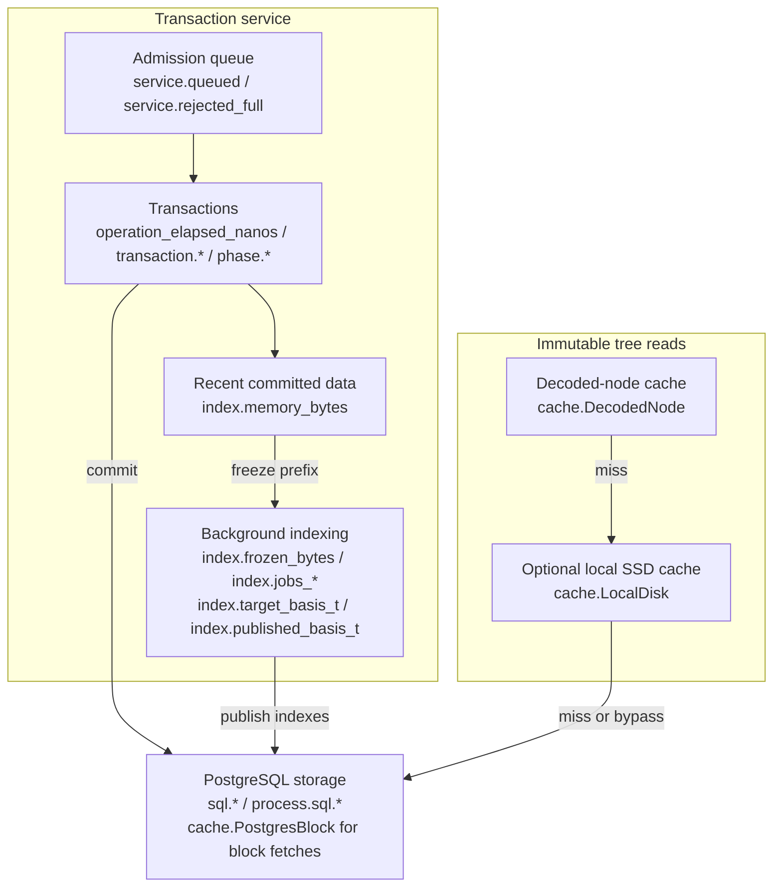

# Monitoring and Performance

EDB exposes native reports and an optional bounded event publisher. No
monitoring server, dashboard, JVM logging runtime or external backend is required.
Applications can send JSON lines to their existing logging/monitoring system.
Detailed read/transaction diagnostics and stock event publication are off by
default. Normal results, stored history and durable receipts are unchanged.

This page covers tuning, application diagnostics, custom monitoring, available
metrics and warnings. Metric names below are the literal fields in JSON events.
Some are cumulative counters, some are current observations, and others are
operation-local statistics; choose aggregations according to that distinction.

## Where to observe work

The following map places observations along the durable write and immutable
tree-read paths. Arrows show work or a read falling through to another tier;
they do not represent telemetry delivery or separate deployed services.



The read path applies to native tree reads wherever they occur, including reads
performed during transaction work. A decoded hit avoids loading that tree node;
a decoded miss can still be served by the local SSD cache. When the SSD cache is
disabled or bypassed, the read proceeds to PostgreSQL. Root capture and
authorization have their own storage requirements, so these arrows describe
block loading rather than every SQL call made by an operation.

Read the map together with the event boundaries: operation and transaction
reports carry `cache.*`, `sql.*`, `transaction.*` and `phase.*` observations when
enabled. Lifecycle snapshots carry `service.*`, `index.*`, `fulltext.*` and
process-wide `process.sql.*` observations. The stock service samples from its
lifecycle loop; application operation reports must be explicitly connected to
the publisher. Both paths feed its bounded queue and then a stdout or custom
sink. A collector turns those events into charts and notifications.

For a growing transaction queue, follow recent/frozen bytes and index publication
progress, then correlate SQL activity with PostgreSQL measurements. For slow
reads, follow decoded misses through the lower tiers before attributing the cost
to storage. Use the warning table below to connect persistent failures or
backpressure with operator action.

## Tuning tips

### Give peers and the transactor enough memory

The more memory you give a process for its caches, the more database indexes it
can cache locally, avoiding trips to storage. Set native process/container limits
through your supervisor and configure the decoded tree cache's entry and byte
budgets separately. Increasing the process limit alone does not increase those
budgets. Leave room for recent data, resident roots/schema, active queries,
transaction assessment, indexing and retained reports. Accounted cache/index
bytes are not process RSS. See [capacity planning](09_capacity_planning.md).

### Use the optional local SSD cache

The [local SSD cache](../09_optional/00_local_cache.md) can serve authenticated
immutable blocks below the decoded-node cache. Enable it with
`EDB_SSD_CACHE_DIR` and size it with `EDB_SSD_CACHE_ENTRIES` and
`EDB_SSD_CACHE_BYTES`. If commonly used blocks fit, repeated reads can avoid
PostgreSQL block fetches. Root capture and authorization still require storage;
cache reuse does not provide disconnected startup.

Diagnostic: if a tier's hit rate is low, compare its working set, occupancy,
evictions and limits before increasing capacity. A larger cache helps only when
the workload reuses data. Cold reads and broad scans can miss even with ample
capacity. Use `Peer::ssd_cache_stats()` or `Connection::ssd_cache_stats()` to
identify corruption and busy/error bypasses as well as ordinary misses.

### Do not benchmark durable performance against the memory database

The eager `Database` is useful for pure computation, development and testing.
Its timings do not include PostgreSQL durability, service admission, native
block loading or background publication. Use representative durable workloads
when measuring a production deployment. Memory is not a substitute for
storage-sized capacity, and resident test data can conceal cache transitions.

### Provision enough storage capacity

Check the [PostgreSQL capacity guidance](09_capacity_planning.md#postgresql).
Correlate SQL durations and errors with PostgreSQL activity, lock waits,
connections and host storage measurements. Queue growth and indexing backlog
can reflect insufficient storage capacity, but they can also reflect expensive
assessment, fulltext or maintenance work. A longer queue does not make those
operations faster.

### Plan large imports and restores

A [backup and restore](11_backup_and_restore.md) workflow can move an already
built database between storage deployments. Measure the import, backup and
restore work for your data and retention requirements before choosing where to
run a large import. EDB has no built-in metered write-capacity model or general
guarantee that restore is cheaper than transactional ingestion. Import pressure
still depends on transaction sizes, index progress and maintenance.

### Use metrics to analyze write activity

The minimum, average and maximum of transaction operation durations, combined
with transaction sizes, characterize observed latency. Collect those statistics
in your monitoring system from `edb.transaction` events. The service creates the
transaction context during submission, so `operation_elapsed_nanos` can include
queueing as well as execution up to the diagnostic capture. It is not a pure
storage-write timer. Transaction phase metrics distinguish expansion, assessment,
encoding, commit and report work where those phases are observed.

To measure latency from the application's perspective, time the call to
`TransactionClient::transact`, or the interval from `submit` through the returned
`TransactionTicket::wait`. Include rejected requests, errors and timeouts in
application metrics; successful transaction events alone do not describe them.
A timeout also does not prove non-commit. Keep fresh commits and exact receipt
replays separate when calculating throughput.

`service.processed` counts successful service responses, including replays.
`transaction.produced_datoms` measures semantic work and `sql.payload_write_bytes`
measures explicitly recorded payloads; neither is a count of network or physical
disk bytes. For committed datom volume, use the transaction report or
[log API](../07_peer_api/06_log_api.md). The event publisher can drop events, so
it cannot serve as an exact throughput ledger.

Pipelining submissions can keep work available to the writer while an application
prepares the next request. Use bounded concurrency and monitor queue occupancy
and rejected admissions. EDB serializes transaction assessment/publication for
a database; more in-flight requests do not create more writers.

## Explain one operation

Use a qualified business label, not a customer ID, query value or credential:

```rust,ignore
use edb_core::{Keyword, OperationContext, OperationKind, io_report_to_edn};

let operation = OperationContext::named(
    OperationKind::Query, Keyword::new("app", "account-summary"),
)?;
let (result, report) = operation.measure(|| database.query(&query, &inputs, &control));
// `result` is the original Result; diagnostics do not turn an error into success.
let edn = io_report_to_edn(&report);
```

`OperationContext::diagnostic(kind)` enables the same detail without a business
name. Existing `OperationContext::new(kind)` keeps its SQL-only behavior. Enter a
context around the actual consumption of lazy cursors, or call `report()` after
consumption; measuring only cursor construction does not measure future work.
Explicit context propagation preserves attribution across workers and cursors.

`child_named` creates a named sub-operation. `report.nested` groups inclusive
statistics. An unnamed phase/submission inherits its nearest named ancestor's
label in the report; a deliberately named child overrides it. Nested totals group
statistics by distinct descendant label; parents and children overlap and must
not be added together. At most 128 labels are retained per context; overflow sets
`nested_truncated` without changing total counts or the operation result. Reports
are local observations, not a global delta obtained by subtracting two concurrent
process snapshots. EDN conversion preserves unsigned counts exactly, using a
big integer above `i64::MAX`.

Stock `edb query --io-context :app/account-summary` and
`edb pull --io-context :app/account-summary` return I/O reports with their
ordinary result. `edb query --query-stats` additionally explains native clause
scheduling. See [query diagnostics](../05_query_and_pull/04_diagnostics.md) for clause paths,
binding names, row flow, phase nesting and capture limits. The native optimizer
remains enabled; diagnostic warnings are investigation aids, not tuning commands.

### Interpret the counters

The [I/O Stats reference](../07_peer_api/08_io_stats.md) provides complete field
tables, named and nested context examples, and guidance on comparing cache,
index and transaction timings.

- SQL `calls` count driver API calls, not packets or protocol round trips. Row
  field bytes and known application payload bytes are distinct measures, neither
  a disk/network traffic measurement nor heap residency.
- `operation_elapsed_nanos` is elapsed operation wall time. SQL call durations,
  nested phase durations and cache tier durations may overlap or run concurrently;
  sums do not reconstruct end-to-end latency.
- Cache observations identify decoded-node, local-disk and PostgreSQL-block
  accesses. Hits/misses, returned physical/canonical payload bytes and duration
  statistics describe that tier. A decoded miss may be served by the local SSD cache; it is not necessarily
  a PostgreSQL request. `CacheTier::Inflight` is
  defined but currently has no observation producer, so its presence in the API
  does not establish separate measurements of loader waits or shared results.
- Index counters name the native order and count cursors, node accesses and
  decoded misses. A query's logical index seek is not a physical storage read.
- Semantic transaction work counts attempted assessments, identity claims/lookups,
  upsert resolutions, uniqueness/redundancy checks, discarded duplicate/redundant
  datoms, composite work, function expansion and produced datoms. These are actual
  native steps, not unique user forms or identical counts across different engines.

`ServiceTransactionReport::diagnostics`, when enabled, contains the committed
basis, replay flag and safe operation report. It is ephemeral process diagnostics,
not new durable receipt content. Exact receipt replay does not re-execute fresh
assessment work merely to reconstruct statistics. An explicitly diagnostic caller
context or configured service telemetry enables the returned detail.

## Custom monitoring

### Publish from a library or stock service

```rust,ignore
use edb_core::{TelemetryConfig, TelemetryPublisher, TelemetrySnapshot,
                  TelemetryPhase, ServiceOptions};
use std::time::Duration;

let publication = TelemetryPublisher::start(
    TelemetryConfig { enabled: true, interval: Duration::from_secs(10),
                      queue_capacity: 64, max_event_bytes: 16 * 1024,
                      ..Default::default() },
    |json_line| existing_log_sink.write_line(json_line), // std::io::Result<()>
)?;
let emitter = publication.emitter();
let options = ServiceOptions { telemetry: Some(emitter.clone()), ..Default::default() };
// Pass options to TransactionService::start_with_options or standby.

// From an existing lifecycle loop: disabled/not-due calls do not capture stats.
emitter.publish_if_due(|| TelemetrySnapshot::capture(
    Some(&client), TelemetryPhase::Active, configured_listeners_ready,
));

// Bounded wait; false means a sink is still executing, not lost writer authority.
let sink_stopped = publication.shutdown(Duration::from_millis(100));
```

`TelemetryPublisher::stdout(config)` writes and flushes one JSON line per event.
Stock `edb transactor --telemetry-ms 10000` enables publication from the existing
lifecycle loop and enables transaction events. Other startup/status lines on
stdout retain their existing format; select JSON event lines in a collector.
The collector must drain stdout during normal operation: startup/status output
uses ordinary synchronous stdout. If the telemetry worker does not stop within
the shutdown wait, the CLI omits its final `STOPPED` stdout line instead of
blocking behind that worker. Telemetry delivery is best effort, not a durable log.
Library users can customize queue/event-byte admission and `TelemetryWarnings`.
There is no hidden periodic sampler: callers choose when to drive
`publish_if_due`. Explicit `try_publish` samples immediately. An
`operation_callback()` or `publish_operation(&report)` bridges operation reports
to the same queue; no sink executes inside the operation/storage lock.

JSON events include `version`, `event`, `level`, publisher-local `sequence` and
wall-clock `unix_millis`. Sequences can have gaps after admission drops and are
not durable order guarantees across processes. Service events correlate by
immutable storage ID/lineage, lease epoch where available, and transaction basis.
No public catalog-name lookup is done during publication; a storage ID initially
chosen from a name may still be recognizable. Named operation labels are explicit
application metadata. Events exclude request keys, tempids, datom values, complete
queries, callback payloads, connection strings and error messages. Error codes
remain available for diagnosis. Keep secrets out of deliberate labels and custom
sink code; custom callback panics still use Rust's configured panic hook.

### Callback argument format

`TelemetryPublisher::start` takes a native Rust callback with signature
`FnMut(&str) -> std::io::Result<()> + Send + 'static`. Its argument is one complete
UTF-8 JSON line, including the newline. The dedicated publisher worker calls it;
return `Ok(())` only when your sink has accepted the line. Delivery in these
statistics means the callback returned successfully, not that a downstream
monitoring backend durably stored it.

The envelope identifies the schema `version` and event type. The `metrics` object
contains numeric scalars and, for operation events, nested cache/index/phase
objects. Snapshot and warning events can also contain booleans, phase strings
and safe error codes. A correct collector should tolerate metric names and
optional fields it has not previously seen. Preserve integers exactly when
possible: unsigned counts can exceed the exact integer range of a floating-point
JSON consumer.

The lower-level `OperationContext::with_callback` takes a `SqlMetricCallback`,
an `Arc<dyn Fn(SqlIoReport) + Send + Sync>`. `publish()` explicitly invokes that
callback synchronously after the caller releases application/storage locks;
`measure()` and dropping a scope do not invoke it. The publisher's
`operation_callback()` provides a callback that only attempts bounded enqueueing.
For a detailed named context, `emitter.publish_operation(&operation.report())`
publishes the report directly.

This complete example bridges an application operation to a custom JSON sink:

```rust
use edb_core::{Keyword, OperationContext, OperationKind,
               TelemetryConfig, TelemetryPublisher};
use std::time::Duration;

fn main() -> Result<(), Box<dyn std::error::Error>> {
    let (sender, receiver) = std::sync::mpsc::channel();
    let publisher = TelemetryPublisher::start(
        TelemetryConfig { enabled: true, ..Default::default() },
        move |line| sender.send(line.to_owned()).map_err(std::io::Error::other),
    )?;
    let emitter = publisher.emitter();
    let operation = OperationContext::named(
        OperationKind::Application, Keyword::new("app", "refresh-summary"),
    )?;
    let (value, report) = operation.measure(|| 42); // Put application work here.
    assert_eq!(value, 42);
    assert!(emitter.publish_operation(&report));
    // This example waits for the sink to receive its single event.
    println!("{}", receiver.recv_timeout(Duration::from_secs(1))?.trim_end());
    let stopped = publisher.shutdown(Duration::from_millis(100));
    let _ = stopped;
    Ok(())
}
```

### Send metrics to your monitoring backend

Forward JSON events through the deployment's log collector or implement a native
sink for your monitoring system. This works independently of where PostgreSQL or
the EDB process runs. The stock publisher supplies stdout and callback delivery;
backend authentication, metric conversion, retention, dashboards and notifications
belong to the collector/deployment. It does not configure CloudWatch or another
hosted monitoring service automatically.

## Available metrics

### Events and warnings

`edb.metrics` reports service queue/processed/rejection totals, index publication
and pressure, fulltext attempts/failures, excision progress and publisher outcomes.
Its `process.sql.*` totals are process-wide, not attributed to a single database.
`edb.operation` and `edb.transaction` contain operation-local metrics and
named descendant groups. Counter names are an open set; consumers should ignore
unrecognized fields. Units are in field names. No host RAM, heartbeat latency or
lease-renewal latency is inferred from a sampling interval.

### Service and process metrics

`edb.metrics` includes the following fields. Service and index fields are absent
when the snapshot has no corresponding service/index observation. Counters are
local observations with lifetimes determined by their owner; they are not durable
transaction history. Do not merge different database lineages, publisher
instances or process lifetimes into one monotonically increasing series.

| Metric | Units | Interpretation |
| --- | --- | --- |
| `process.sql.calls` | Calls | Process-wide cumulative observed driver calls |
| `process.sql.errors` | Errors | Cumulative failed calls and stream-consumption errors |
| `process.sql.result_cell_bytes` | Bytes | Cumulative returned binary SQL field bytes |
| `process.sql.elapsed_nanos` | Nanoseconds | Cumulative driver-call durations; concurrent time is additive |
| `service.queued` | Requests | Current admitted requests awaiting service |
| `service.max_queued` | Requests | Queue high-water mark in this service lifetime; not its configured capacity |
| `service.processed` | Responses | Successful service responses, including exact replays |
| `service.rejected_full` | Requests | Cumulative full-queue admission rejections |
| `index.published_basis_t` | Basis | Most recently adopted authenticated publication's transaction basis |
| `index.target_basis_t` | Basis | Committed frontier targeted by indexing |
| `index.pending_avet_projections` | Jobs | Broad AVET projection work represented by the adopted manifest |
| `index.memory_bytes` | Accounted bytes | Recent committed data outside the frozen indexing prefix |
| `index.frozen_bytes` | Accounted bytes | Frozen prefix being indexed |
| `index.jobs_started`, `index.jobs_completed`, `index.jobs_failed` | Jobs | Index worker progress/failure counters |
| `index.backpressure_stalls` | Stalls | Times the writer stopped ordinary dequeueing under indexing pressure |
| `index.backpressure_rejections` | Requests | Full-queue rejections while indexing pressure parks the writer |
| `fulltext.attempts`, `fulltext.failures` | Attempts | Coherent index/search projection attempts and whole-job failures |
| `excision.steps` | Steps | Observed excision progress |
| `excision.source_transactions` | Transactions | Loaded source transactions in completed rewrite checkpoints |
| `excision.source_payload_bytes` | Bytes | Accounted source payload processed by excision |
| `excision.peak_admitted_bytes` | Accounted bytes | Peak maintenance admission; not allocator RSS |
| `excision.rows_staged` | Entries | Source receipt entries advanced; not SQL write count |
| `excision.complete`, `excision.phase` | Boolean, string | Excision completion and current phase observations |
| `telemetry.accepted`, `telemetry.delivered` | Events | Events enqueued and callbacks successfully completed |
| `telemetry.dropped_full`, `telemetry.dropped_oversize` | Events | Whole events rejected by queue or encoded-size limits |
| `telemetry.dropped_stopped`, `telemetry.dropped_shutdown` | Events | Rejected after stop or discarded during shutdown |
| `telemetry.sink_errors`, `telemetry.sink_panics` | Events | Sink calls returning errors or panicking |
| `telemetry.bytes_delivered` | UTF-8 bytes | Complete JSON lines whose sink callbacks succeeded |

The metrics event captures publisher counts while encoding itself. Its own
acceptance/delivery is consequently not included in that capture. A missing
sample can mean the lifecycle loop did not sample, publication dropped it, or the
sink failed; it does not alone establish that the writer stopped.

`TransactionClient::stats()` additionally exposes report-subscriber retention:
subscriber count, queued reports, payload bytes, high-water marks, oldest pending
basis and distinct retained roots/generations. It can help diagnose a consumer
that is retaining old database values. Those fields are not sampled by the stock
publisher. `writer_residency_stats()` reports representation-level writer state;
`background_indexing_stats()` includes job-in-flight, detailed recent/frozen
counts, retry state and failures. These native snapshots provide more detail
than the bounded JSON metric selection and may contain failure messages; apply
your application's logging policy before forwarding them.

### Operation and transaction metrics

`edb.operation` and `edb.transaction` use the same metric fields. Transaction
events additionally identify `basis_t` and `replayed`. The full native report
has additional SQL-call/stream details; see the
[I/O Stats reference](../07_peer_api/08_io_stats.md#the-io-stats-map).

| Metric or object | Units | Interpretation |
| --- | --- | --- |
| `operation_elapsed_nanos` (envelope) | Nanoseconds | Time from context creation to report capture |
| `sql.calls`, `sql.errors`, `sql.rows` | Counts | Driver calls, errors and returned rows attributed to the operation |
| `sql.result_cell_bytes` | Bytes | Returned binary SQL field bytes |
| `sql.elapsed_nanos` | Nanoseconds | Sum of driver-call durations |
| `sql.payload_read_bytes`, `sql.payload_write_bytes` | Bytes | Explicitly recorded application payload sizes |
| `transaction.assessments`, `transaction.input_operations` | Counts | Semantic assessments and input operations assessed |
| `transaction.identity_claims`, `transaction.identity_lookups`, `transaction.upsert_resolutions` | Counts | Identity and upsert work |
| `transaction.uniqueness_checks`, `transaction.redundancy_checks` | Checks | Performed validation/comparison work |
| `transaction.redundant_datoms`, `transaction.duplicate_datoms` | Datoms | Discarded redundant or duplicate datoms |
| `transaction.composite_candidates`, `transaction.composite_datoms` | Counts | Composite candidate and produced-composite work |
| `transaction.function_calls`, `transaction.produced_datoms` | Counts | Function expansion and produced datoms |
| `cache.DecodedNode`, `cache.LocalDisk`, `cache.PostgresBlock` | Objects | Per-tier accesses, hits, misses, errors, bytes and durations |
| `index.Eavt`, `index.Aevt`, `index.Avet`, `index.Vaet` | Objects | Per-order cursors, node accesses and decoded misses |
| `phase.<OperationKind>` | Object | Phase `invocations` and summed `elapsed_nanos` |

Cache objects contain `accesses`, `hits`, `misses`, `errors`, `physical_bytes`,
`canonical_bytes`, `elapsed_nanos`, `min_nanos` and `max_nanos`. Index objects
contain `cursors`, `node_accesses` and `decoded_misses`. Absent objects indicate
no captured observations for that tier/order, which can include disabled
diagnostics. Presence of `CacheTier::Inflight` in the type does not imply a
currently emitted metric. Error accesses also contribute a hit/miss classification;
inspect `errors` separately when interpreting success.

### Calculate statistics in a collector

If you analyze JSON lines yourself, take additional steps to interpret metrics.
For a nonzero cache `accesses` count, calculate:

- Hit rate as `hits / accesses`.
- Misses as `accesses - hits` (also reported as `misses`).
- Mean tier duration as `elapsed_nanos / accesses`.

For example, 95 hits among 100 accesses yield a hit rate of 0.95. When combining
independent operation reports, divide the sum of hits by the sum of accesses;
do not average percentages from operations with different access counts. Combine
minimum/maximum values only from observations with nonzero accesses. For phase
averages divide `elapsed_nanos` by `invocations`. To report milliseconds, divide
nanoseconds by 1,000,000.

For cumulative service/process counters, compute interval deltas within one
owner's lifetime before deriving rates. Handle restarts and reset observations
explicitly. For gauges such as `service.queued` and `index.memory_bytes`, retain
sample values or compute interval min/max; summing samples does not count work.
Index pressure is the sum of live `index.memory_bytes` and
`index.frozen_bytes`, so monitor both. Operation reports and named descendant
groups are inclusive: adding overlapping reports double-counts work.

## Alarms and troubleshooting

Your monitoring backend can raise an alarm when a metric is outside a chosen
range for a defined period, then notify an operator. Configure notifications for
writer unavailability and persistent indexing failures, and choose queue/latency
thresholds according to your workload. EDB emits warning events rather than one
aggregate `Alarm` counter. A warning does not itself send a page or resize a
resource.

Configurable warnings are emitted at sampling opportunities:

- `writer_unavailable`: an active/failed lifecycle reports unavailable writer
  authority. This can follow lease loss or another worker failure; it does not
  assert a specific cause or perform a fresh SQL lease check.
- `not_ready`: an active lifecycle lacks writer availability or listener readiness.
- `backpressure`: rejected admission increased since the preceding sample for
  that identity, or the optional configured queued-request threshold is met.
- `indexing_failed` / `fulltext_failed`: a corresponding current failure exists.
- `excision_paused`: an excision failure/admission pause remains observable.

The complete event name has the `edb.warning.` prefix. Persistent conditions
may warn at each interval; rejected-count increases are compared with the previous
sample. Recovered state is visible in subsequent snapshots. These events are not
a paging service or an independent health/lease oracle. Configure thresholds for
your deployment, and retain `/health` versus `/ready` for supervisor checks.

| Warning or symptom | Recommended action |
| --- | --- |
| `edb.warning.writer_unavailable` | Check lifecycle state, writer lease/fencing and storage/connection failures. A standby waiting to acquire authority is a different state. |
| `edb.warning.not_ready` | Check listener startup and writer availability; use the service readiness endpoint for supervisor decisions. |
| `edb.warning.backpressure` | Compare admitted load, queue occupancy, recent/frozen bytes and index progress. Bound submissions and investigate whether storage, assessment or maintenance is limiting progress. |
| `edb.warning.indexing_failed`, `edb.warning.fulltext_failed` | Inspect the safe error code, native failure detail and PostgreSQL health. Fulltext observations cover the coherent projection job, including preparation and adoption. |
| `edb.warning.excision_paused` | Check maintenance admission and failure detail; follow [maintenance controls](04_maintenance_controls.md). |
| Rising SQL durations/errors | Correlate with PostgreSQL activity, locks and network/storage health. Call durations alone do not distinguish these causes. |
| Slow queries with low SQL activity | Inspect [query diagnostics](../05_query_and_pull/04_diagnostics.md), intermediate row growth, native work and cache/index observations. |
| Growing report retention | Inspect `TransactionClient::stats()` and drain or drop report subscriptions that the application no longer needs. |
| Rising telemetry drops or sink failures | Check collector throughput, sink errors and queue/event-size settings. Enlarging the queue only absorbs a bounded burst. |

## Cost, backpressure and shutdown

One optional worker invokes the sink. Producers encode a bounded JSON line, take
a short in-memory admission lock and use `try_send`; they never wait for sink I/O.
The configured queue holds at most `queue_capacity` lines, each with an encoded
limit of `max_event_bytes`, plus one active sink event and temporary producer
encoding buffers. Concurrent producers and a callback's own memory are not covered
by this queue bound; it is not an allocator/RSS guarantee. Sampling uses fixed
service/index aggregates, does not scan queued reports, makes no SQL calls and
does not copy failure messages. Existing local locks can briefly contend.

Oversized or full-queue events are dropped as whole events, never truncated into
invalid JSON. `TelemetryStats` and subsequent metrics expose accepted/delivered,
full/oversize/stopped/shutdown drops, sink errors/panics and delivered bytes.
Accepted means queued, not durably logged. Sink failures do not fail a transaction;
panic containment allows later attempts, subject to the application's panic hook.

`request_stop`, Drop and `shutdown` stop new admission and discard pending events.
`shutdown(timeout)` waits at most for its completion notification; if a callback,
its destructor or stdout write does not return, the worker is detached and owns
that work until it finishes. It cannot be forcibly cancelled safely. Do not
repeatedly create publishers around permanently blocked sinks. Disabled mode
starts no worker and `publish_if_due` does not invoke its snapshot closure.

Use existing application logging/monitoring sinks; no vendor backend or
particular logging framework is required.

## Internal monitoring

Build collectors around the documented public reports and events. Other internal
counters, debug output and implementation-specific messages can change as the
engine evolves. Do not parse undocumented log text as a stable operational API.

EDB does not infer host RAM, allocator pressure, PostgreSQL WAL throughput,
heartbeat latency or lease-renewal latency from its existing counters. Collect
host and PostgreSQL telemetry separately and correlate it with database identity,
lifecycle and operation reports. An interval is a sampling policy, not a
measurement of how long a heartbeat or lease renewal took.
