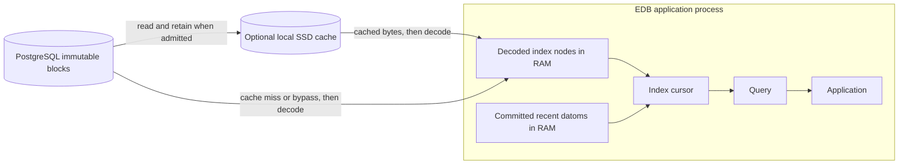

# Optional local SSD cache

Moving data closer to processing can reduce storage reads. EDB's optional local
cache stores immutable blocks on disk, providing a capacity tier between memory
and PostgreSQL. The cache:

- Is transparent to application reads.
- Caches immutable blocks of [indexes](../06_indexes/00_indexes_and_log.md),
  [logs](02_log_cache.md) and other scoped read objects. A new transaction does
  not make an old block stale; capacity eviction and retention still apply.
- Runs inside the EDB process, using a local directory. Cooperating processes
  can share that directory with the same limits.
- Can use an SSD to provide more capacity than the application's RAM budget.
- Can stay warm across process restarts when the process reuses the same disk
  and access namespace.
- Reduces reads from PostgreSQL when requested blocks are present and valid.

It is a disposable cache, not a database backup or a replacement for PostgreSQL
availability. Its benefit depends on the workload, cache capacity and storage.

## Prerequisites

Create a dedicated private directory on a local filesystem, owned by the
process user with mode `0700`. The directory must already exist and be empty
when first claimed by EDB. Cache files are owned, mode `0600`, regular files.
Do not put application files in this directory.

The path cannot contain symlinks or `..` traversal. Ancestor directories must be
owned by the process user or root, and cannot be group- or world-writable unless
they have the sticky bit. The filesystem must support the file locking and
hard-link operations used for cooperative access and entry publication.

SSD hardware is not required, although the storage device affects performance.
There is no `strictatime` or `lazytime` mount requirement. EDB updates a block's
modification time on a successful hit and uses modification times to select
older entries for eviction; it does not depend on filesystem access times.

## Configuration

For executables or applications using `postgres_config_from_env()`, set these
[environment variables](../08_operations/14_configuration_reference.md):

| Environment variable | Value | Default |
| --- | --- | --- |
| `EDB_SSD_CACHE_DIR` | Existing private cache directory | Unset; caching disabled |
| `EDB_SSD_CACHE_ENTRIES` | Positive maximum number of block files | `4096` |
| `EDB_SSD_CACHE_BYTES` | Positive maximum physical block-file bytes | `1073741824` (1 GiB) |

For example, with `EDB_POSTGRES_URL` already configured and `/mnt/ssd` prepared
for the application user, create a new cache directory and configure the process:

```sh
mkdir -m 700 /mnt/ssd/edb-cache
export EDB_SSD_CACHE_DIR=/mnt/ssd/edb-cache
export EDB_SSD_CACHE_ENTRIES=4096
export EDB_SSD_CACHE_BYTES=1073741824
```

Start the EDB application from that environment. Setting either limit without
`EDB_SSD_CACHE_DIR` returns `config/ssd-directory-required`; zero or malformed
limits return `config/positive-integer`. Without the directory setting and
limits, SSD caching is disabled.

The library equivalent configures the connection directly:

```rust
use edb_core::{PostgresConnectionConfig, SsdCacheConfig, SsdCacheLimits};

fn with_local_cache(config: PostgresConnectionConfig) -> PostgresConnectionConfig {
    config.with_ssd_cache(SsdCacheConfig {
        directory: "/mnt/ssd/edb-cache".into(),
        limits: SsdCacheLimits {
            max_entries: 4096,
            max_bytes: 1024 * 1024 * 1024,
        },
    })
}
```

Pass the resulting configuration when opening the native peer or connection.
Opening validates the cache directory. All processes sharing that directory
must use the same limits; the limits apply to all namespaces together. Physical
byte accounting includes block-file framing, excludes the fixed ownership
record, and measures file lengths rather than filesystem allocation. Admission
reserves space for its staging block. An object larger than the byte limit
bypasses retention; otherwise admission evicts older entries until both limits
are satisfied.

## Opening and failures

Unsafe paths or conflicting limits fail opening clearly. Concurrent
initialization retries its directory lock for one second before returning
`cache/busy`. A crash before publishing the ownership record can leave an
unclaimed initialization file: opening then reports `cache/unsafe-config` and
preserves it. Inspect that directory or choose a new empty private root; these
uncertain files are not automatically deleted.

Malformed owned files at recognized `.block` names do not prevent reopening:
the cache reports corruption and `inventory_complete=false`, preserves those
files, and bypasses writes and purge. Reads of unusable entries fall back to
PostgreSQL. Reported occupancy includes their physical sizes. Unknown files,
unsafe permissions or links still reject opening; malformed framing is not
permission to delete them. A correctly framed entry whose payload fails
hash authentication is removed when detected during a read.

Runtime contention, corrupt entries or disk errors fall back to PostgreSQL.
An unsuccessful cache write does not make an otherwise successful database
read fail. If PostgreSQL cannot supply the required valid object, the database
read can still fail; cache fallback does not manufacture missing data.

## Isolation and authentication

New peers still authorize and authenticate their root through PostgreSQL. Cache
names separate connection/trust configuration, database lineage, excision
generation and format; they are not authorization tokens. Different raw
connection parameters or trust roots intentionally use different namespaces,
even if they name the same server.

An SSD hit supplies hash-authenticated canonical bytes under the captured
reader's protection. A new live capture still needs PostgreSQL authority; SSD
reuse does not promise disconnected startup or indefinitely available
historical data. Fully resident RAM reads avoid foreground SQL within the
stated [retention policy](../08_operations/04_maintenance_controls.md).

## Monitoring the cache

Use `Peer::ssd_cache_stats()` or `Connection::ssd_cache_stats()` to inspect the
cache. Counters belong to the shared handle within the process; they are not
persistent, cluster-wide metrics. Occupancy is the last observed state of the
shared directory, including other namespaces, rather than a continuous scan.

| Fields | Meaning |
| --- | --- |
| `hits`, `misses` | Successful enabled-cache lookups and unsuccessful enabled-cache lookups, including error bypasses |
| `puts`, `evictions`, `purged_entries` | Successful admissions, capacity evictions and explicit purge removals |
| `corruptions`, `corrupt_entry_bypasses` | Detected corruption and operations bypassed for malformed entry framing |
| `busy_bypasses`, `io_errors` | Lock contention and other disk/path errors |
| `oversized_bypasses`, `disabled_bypasses` | Objects too large to admit and operations bypassed because caching is disabled |
| `physical_read_bytes`, `physical_write_bytes` | Physical bytes read or successfully written, including entry framing |
| `canonical_read_bytes`, `canonical_write_bytes` | Authenticated canonical bytes returned or successfully admitted |
| `current_entries`, `current_bytes` | Last observed shared-directory occupancy, including recognized malformed files |
| `peak_entries`, `peak_bytes` | Highest occupancy observed by this handle |
| `inventory_complete` | Whether the last inventory completed without recognized malformed files; false prevents writes, eviction and purge |

For an interval with enabled-cache requests, compute hit ratio as
`delta(hits) / (delta(hits) + delta(misses))`. A denominator of zero means there
were no such requests. Disabled-cache bypasses are counted separately. These
are SSD lookup statistics: a decoded RAM hit does not require an SSD request.
Use [I/O statistics](../07_peer_api/08_io_stats.md) to compare the `DecodedNode`,
`LocalDisk` and `PostgresBlock` tiers for an operation.

## Local disk and memory caching

For a query over a captured database value, index reads combine the durable
index with committed transactions in the recent tier. The diagram shows data
flow into those reads:



A durable node lookup checks decoded RAM first, then the optional SSD cache,
then PostgreSQL. Bytes read from PostgreSQL are offered to the SSD cache;
decoded nodes are offered to the RAM cache. The recent tier participates in
the index scan independently of this durable-node cache hierarchy.

The same configured block reader is used by the
[transactor](../08_operations/07_transactor_reference.md) and
[index maintenance](../06_indexes/02_background_indexing.md) for their reads.
Each process must receive its cache configuration. Transaction commits and
index publication still write authoritative state to PostgreSQL.

You can use the SSD tier in addition to the
[decoded memory cache](../08_operations/12_memory_and_caching.md), and choose
its configuration independently per process. RAM retains decoded nodes; the
SSD tier retains immutable block bytes that must still be decoded. A disk
cache can retain more data without charging it to the decoded RAM cache budget,
but disk access and decoding still have costs. Measure cold reads, repeated
reads and process restarts separately before selecting limits.

EDB's local directory is not a Memcached service or a distributed cache cluster.
It runs with the reading process, and reuse depends on the disk's lifecycle.
Two deployment cases limit its usefulness:

- Your peer instances do not have suitable local storage.
- New processes cannot reuse disks populated by previous processes. This is
  often the case when instances and their disks are ephemeral.

Reusing a persistent volume can preserve cache contents across a restart;
replacing the volume starts with a cold cache. Changing connection or trust
configuration can also make existing entries ineligible for reuse. No particular
latency, price advantage or availability improvement is guaranteed.

## Disk lifecycle and sensitive data

Files are private but not encrypted. They may contain personal or sensitive
data. Excision does not automatically remove existing local copies, backups or
RAM values. `purge_ssd_generation(generation)` removes recognized entries of
that generation from this cache root and access namespace, returning false on
a busy/error path. It is not secure erasure and does not purge other processes'
differently configured namespaces. An already-held old value can populate its
cache again after a purge.

Retire obsolete cache roots explicitly under your data-retention policy.
Coordinate retirement with processes using the directory; retaining the same
volume preserves old cache data as well as its performance benefit.
