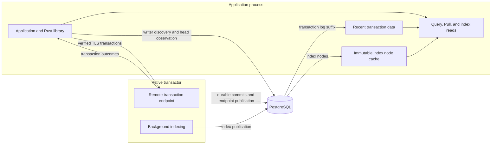

# Remote Transactions

The Rust library can be used to connect applications on other hosts to EDB:

- It submits transactions to the transactor's remote endpoint.
- It supports query, Pull, entity, index, and log reads in the application process.
- It reads durable data directly from PostgreSQL and maintains local caches.
- It provides synchronous APIs and an asynchronous facade over the same native engine.



[Peer applications](../00_start_here/02_peer_library.md) using local transaction
submission and applications using remote submission share the same database
model. Remote submission changes the transaction transport; reads still use the
application's captured database values and PostgreSQL credentials.

Local reads combine immutable index trees with recent transaction data beyond
the published index basis. The application caches index nodes fetched from
storage, while the transactor's background indexing publishes newer trees.
The connection observes durable changes through PostgreSQL; the transaction
endpoint does not push a live index to readers. Captured database values remain
immutable as the connection adopts newer values. See
[background indexing](../06_indexes/02_background_indexing.md) and
[memory and caching](../08_operations/12_memory_and_caching.md).

## Remote Transaction Endpoint

The remote transaction endpoint is a TLS listener attached to an active
`TransactionService`. It:

- Accepts authenticated transaction requests from applications.
- Submits transactions to the fenced writer and returns their outcomes.
- Publishes its address, TLS server name, database identity, lease epoch, and
  listener instance through PostgreSQL for discovery.

The endpoint provides a gateway for transactions. Query evaluation and caching
remain in the application's `Connection`, including when the application uses
`AsyncClient`. A cold read can require PostgreSQL access, but a query is not sent
to the transaction endpoint. The endpoint provides no HTTP query API or separate
lightweight query-client mode.

Remote transaction submission requires a running transactor with a published
endpoint and current writer authority. Additional application peers can perform
reads independently; adding transaction listeners does not create additional
active writers for a database. See [deployment](../08_operations/08_deployment_reference.md)
and [high availability](../08_operations/10_high_availability.md).

## Running the Remote Endpoint

The transactor communicates with PostgreSQL to process transactions and publish
its endpoint. The system running it must have writer permissions to storage, as
specified in [storage setup](../08_operations/06_storage_services.md). Each
application must also be able to reach PostgreSQL with its own peer credentials,
and connect to the transactor at the published numeric address and port.

Install storage and create the logical database separately with administrative
credentials. The runtime command opens an existing database; starting the
endpoint does not create or destroy it. See [administration](../08_operations/01_administration.md).

Build the executable from the EDB checkout root:

```sh
cargo build --locked --bin edb
```

### Credentials and TLS

Configure these environment variables in the transactor's environment:

| Variable | Value |
| --- | --- |
| `EDB_POSTGRES_URL` | PostgreSQL connection string with writer credentials |
| `EDB_POSTGRES_TLS_ROOT` | Optional additional PEM trust root for PostgreSQL |
| `EDB_REMOTE_TLS_CERT` | Path to the remote endpoint's PEM certificate chain |
| `EDB_REMOTE_TLS_KEY` | Path to its PKCS8 PEM private key |
| `EDB_REMOTE_TOKEN_FILE` | Path to a file containing a shared 256-bit token as 64 hexadecimal digits |

Provision the certificate with a server name that clients can verify. Generate
the token with a cryptographically secure random source and distribute it
privately to authorized applications. For example, to create a new token file
in an existing private directory:

```sh
(umask 077; openssl rand -hex 32 > /private/edb/remote-token)
```

Use a new path when generating a token; overwriting an active token file does
not update credentials already loaded into running processes. The private key
and token must be regular files owned by the process user, with no group or
other permissions, typically mode `0600`. The environment loaders reject
symlinks and nonregular credential files. Certificate, key, and optional root
files are limited to 1 MiB each; the token file is limited to 1 KiB and may have
surrounding whitespace.

The server accepts one token per listener. Possession grants transaction
submission to that server's database; it does not grant PostgreSQL reads. There
are no access-key/secret pairs or repeated credential options for overlapping
key rotation. Coordinate credential replacement and process restarts with
clients. Keep tokens and private keys out of command-line arguments and logs.

### Launching the Transactor

With an existing database named `application-demo`, writer PostgreSQL
configuration, and provisioned credential files:

```sh
export EDB_REMOTE_TLS_CERT=/private/edb/server-chain.pem
export EDB_REMOTE_TLS_KEY=/private/edb/server-key.pem
export EDB_REMOTE_TOKEN_FILE=/private/edb/remote-token

target/debug/edb transactor \
  --database application-demo \
  --listen 0.0.0.0:7443 \
  --advertise 192.0.2.10:7443 \
  --tls-server-name edb.example.com \
  --health-listen 127.0.0.1:8080
```

Replace the example advertised address with a reachable numeric unicast address
and `edb.example.com` with the certificate's server name.

- `--listen` supplies the local numeric IP address and port. It may use a
  wildcard address.
- `--advertise` supplies the address applications use. It cannot be a wildcard
  or multicast address. An advertised port of zero is replaced with the actual
  listener port before publication.
- `--tls-server-name` supplies the name checked against the server certificate;
  it is separate from the numeric routing address.
- `--database` selects one existing database. The executable does not accept
  repeated database options to serve multiple databases from one invocation.
- Choose exactly one of `--listen` or the same-host `--endpoint` option.

Wait for the `READY` line before submitting transactions. The default `active`
mode fails on writer contention. `--mode auto` waits as a standby and publishes
the endpoint after acquiring writer authority. The
[transactor reference](../08_operations/07_transactor_reference.md) describes
lease, admission, indexing, shutdown, and timeout settings.

For transient development data, use [in-memory database values](../01_tutorials/02_in_memory.md)
inside your application. There is no memory-only database URI for this remote
listener; the stock remote transactor uses PostgreSQL.

## Installing the Client Library

The `edb-core` crate includes both the synchronous connection APIs and
[`AsyncClient`](../07_peer_api/01_async_client.md). The current remote transport
APIs are available on Unix targets. Add the checkout as a path
dependency, adjusting the path for your application:

```toml
[dependencies]
edb-core = { path = "/path/to/EDB" }
```

The same native library performs local reads and remote transaction submission.
The [EDN command-line interface](../01_tutorials/00_edn_workflow.md) can also
submit transactions from files. See [language support](../00_start_here/03_language_support.md)
for the supported application interfaces.

## Connecting to the Remote Endpoint

Configure the application with:

- `EDB_POSTGRES_URL` for peer storage access, and `EDB_POSTGRES_TLS_ROOT` if needed.
- `EDB_REMOTE_TOKEN_FILE` containing the same token as the transactor.
- Optional `EDB_REMOTE_TLS_ROOT`, a PEM trust anchor added to the system trust
  roots for the transaction endpoint.

The connection between the application and remote endpoint uses verified TLS,
at least TLS 1.2. Certificate and server-name verification cannot be disabled
through this API; there is no plaintext transaction mode. PostgreSQL has its own
[connection configuration](../08_operations/14_configuration_reference.md).

Open the database and create a routed writer from that connection:

```rust
use edb_core::{
    Connection, SemanticError, TransactionRequest,
    postgres_config_from_env, remote_client_config_from_env,
};
use std::time::Duration;

fn main() -> Result<(), SemanticError> {
    let postgres = postgres_config_from_env()?;
    let conn = Connection::connect_configured(
        postgres.clone(), "application-demo", 128,
    )?;
    let writer = conn.remote_writer(postgres, remote_client_config_from_env()?);

    let request = TransactionRequest::from_edn(
        "example/name-schema-v1",
        r#"[{:db/ident :example/name
             :db/valueType :db.type/string
             :db/cardinality :db.cardinality/one}]"#,
    )?;
    let committed = writer.transact(request, Duration::from_secs(30))?;
    println!("committed basis: {}", committed.basis_t);
    match committed.report {
        Ok(report) => println!("database basis: {}", report.db_after.basis_t()),
        Err(error) => eprintln!("committed; report unavailable: {}", error.code),
    }
    Ok(())
}
```

`remote_writer` captures the connection's stable database identity and performs
no I/O at construction. Its first submission discovers the writer through
PostgreSQL; later submissions can reuse the cached route. Before transmitting
transaction data, the client verifies that the server matches the discovered
database lineage, writer lease, and listener instance. Reusing a database name
or a network address cannot redirect a captured connection to another lineage.

To submit an existing transaction file from the command line:

```sh
target/debug/edb transact \
  --database application-demo \
  --remote \
  --file transaction.edn \
  --request-key application-change-001 \
  --timeout-ms 30000
```

The CLI discovers the endpoint for this submission. Lower-level Rust callers
can likewise use `Connection::discover_remote_writer` followed by
`transact_remote` or `transact_remote_with_hints`. Use the routed writer when
you want connection-owned route caching. On async executor threads, use
`AsyncClient::transact_routed` with a `RemoteWriter`.

### Health Check

The optional `--health-listen` address is a separate, plaintext, status-only
HTTP listener. With the launch command above:

```sh
curl --fail http://127.0.0.1:8080/health
curl --fail http://127.0.0.1:8080/ready
```

An active process responds with HTTP 200 and:

```json
{"live":true,"ready":true,"state":"active"}
```

During startup or standby, `/health` returns 200 and `/ready` returns 503.
Stopping or failed phases return 503 for both. These checks report the process
phase; they do not execute a database query or independently verify storage
integrity. Keep the listener within the intended monitoring boundary. There is
no `/health` HTTP route on the TLS transaction port.

## Limitations

Query and datom iteration execute in the application process, so there is no
remote query cursor requiring sticky sessions. Transaction routing follows the
published active writer. A load balancer that sends a request to a different
listener instance will fail the discovered-instance check; it cannot distribute
writes across arbitrary transactors.

`RemoteWriter` can rediscover and try a replacement endpoint once when a stale
or unavailable route is detected before the transaction request is written.
It never automatically resubmits an ambiguous transaction. After an unknown
outcome, retry explicitly with the same request key, transaction data, and
options. A timeout is not proof of rollback. A confirmed commit remains
confirmed even if opening its local report fails, as handled in the Rust
example. See [error handling](../07_peer_api/07_error_handling.md).

The server bounds simultaneous requests, frame size, and the cumulative TLS
handshake/request/response deadline. Defaults are four in-flight requests, a
30-second deadline, and a maximum frame of 64 MiB plus 48 bytes. The CLI exposes
`--max-in-flight`, `--request-timeout-ms`, and `--max-frame-bytes`; its EDN input
files have a separate 16 MiB limit. Admission limits can reject excess traffic.

Routed submission includes discovery in its time budget and tightens PostgreSQL
I/O limits to the remaining budget. This is not a preemptive bound on all
connection setup or report construction. Applications still need storage I/O
policies, read-cache capacity, and query limits appropriate to their workload;
moving transaction submission across the network does not remove those costs.
